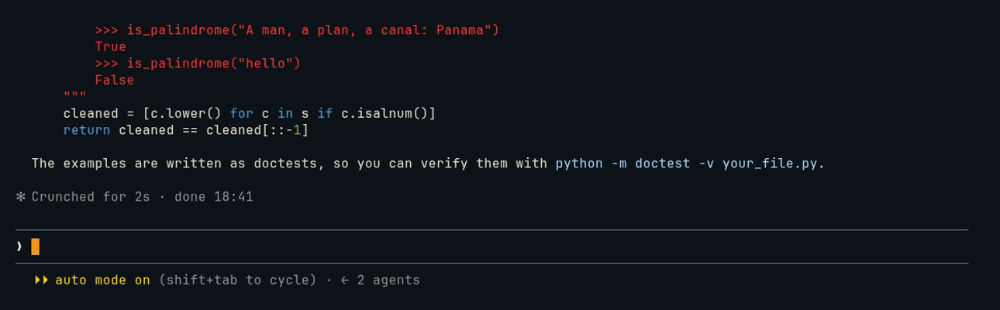
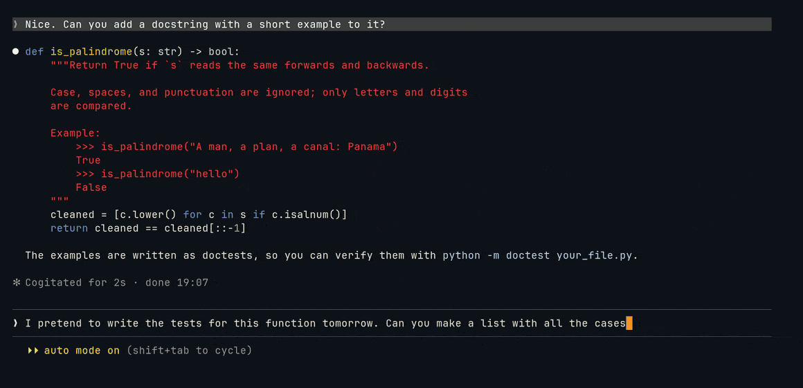

# english-companion

A [Claude Code](https://claude.com/claude-code) mod that helps you write your prompts in English, or in
any language you are learning. It never blocks, rewrites or delays what you type or send.



*While you type: a draft in another language gets a yellow warning under the prompt, and it goes away once
you write in English.*



*After you send: Haiku reviews your writing and leaves a short tip under the prompt, with 📝 for mistakes and
✨ for more natural wording. Press `1` for the details, here a false friend from the writer's first language
and a shorter way to say the same thing, or `2` to dismiss.*

## Install

At the prompt of a terminal session:

```
/plugin install english-companion --marketplace ThaisBarrosAlvim/claude-code-english-companion
```

Or from a shell:

```bash
claude plugin install english-companion --marketplace ThaisBarrosAlvim/claude-code-english-companion
```

**Requirements:** `python3` 3.7 or newer for the language warning, on Linux, macOS or WSL. The review
needs nothing beyond Claude Code. Tested on Linux and WSL with Claude Code 2.1.311 and 2.1.323.

## Settings

Change them with `/plugin configure english-companion@english-companion`, then run `/reload-plugins`.

| Setting | Default | What it does |
|---|---|---|
| `targetLanguage` | `English` | The language you want to write in, by name or code. A draft in any other language gets the warning, and the review checks your writing in this one. |
| `nativeLanguage` | empty | Your first language, so the review understands mistakes that come from it, such as false friends. Left empty, the review works it out from the mistakes. |
| `reviewEnabled` | on | The Haiku review after you send. Each reviewed prompt is one extra Haiku call on your account. |
| `sensitivity` | `normal` | `low`: only clear mistakes. `normal`: up to 2 fixes and 2 improvements. `high`: up to 3 of each. |
| `ignorePunctuation` | off | Never report commas, apostrophes, accents and other punctuation. |
| `extraInstructions` | empty | Your own rules for the reviewer, such as `Ignore missing commas.` |

## How it works

- **The warning** uses fastText's [language identification model](https://fasttext.cc/docs/en/language-identification),
  which knows 176 languages, read by a small pure-Python server (`server/`) with no dependencies. The mod starts
  the server when it is needed. It is shared by every open chat and exits after 30 idle minutes. Drafts go over a
  local Unix socket, and nothing about the warning leaves your machine.
- **The review** asks Haiku through your Claude Code session. It is skipped for prompts under 6 words, slash
  commands, shell lines and drafts in another language. A suggestion must quote your text to be shown, and the
  letters that changed are underlined.
- **Limits:** very short drafts, or drafts made mostly of code and names, are hard to judge, so the warning stays
  quiet on them. The review is a model and can be wrong; the settings above let you steer it.

## Development

```bash
npm test                  # Node tests, then python3 -m unittest; nothing from pip
claude plugin validate .  # the manifest, the marketplace file and the hooks module
```

## License

The code is [MIT](LICENSE). `model/lid.176.ftz` is fastText's model and stays under CC BY-SA 3.0; see
[THIRD_PARTY_NOTICES.md](THIRD_PARTY_NOTICES.md).
